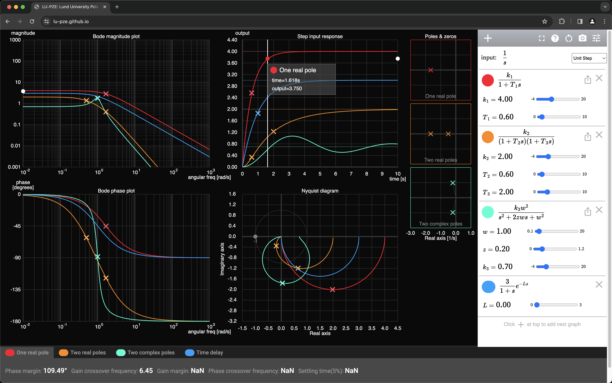

# LU-PZE - Lund University Pole-Zero Explorer
an Automatic Control theory playground


Inspired by Desmos: https://www.desmos.com/calculator

Inspired by ILM Physical Modeling: https://www.researchgate.net/publication/289050547_Interactive_Learning_Module_Basic_Modelling_and_Identification_Concepts

Based on Math.js: https://github.com/josdejong/mathjs

Based on MathLive: https://cortexjs.io/mathlive/

Based on Bowde: https://github.com/nnnawi/BOWDE

Based on p5.js: https://p5js.org/


Here's a screenshot:


...but please run the live version yourself: https://lu-pze.github.io


## Development

LU-PZE is a static web page. There is no build step, no bundler and no transpiler: you edit a file, reload the page and see the change. GitHub Pages serves the site straight from this repository, so whatever is on `main` is what the students get.

### Running it locally

Serve the repository root with any static web server, for example

```
python3 -m http.server 8000
```

and open http://localhost:8000. Opening `index.html` straight from disk (`file://`) half works, but images, sounds and some browser features are unreliable that way.

Two URL parameters help while developing. `?debug` logs every event to the browser console, and `?p=<place>` tags the session with a location name.

### Installing the test tools

You need Node.js and npm for the tests and the linter, and Python 3 for the browser tests' web server. The app itself never uses Node. Install the tools once:

```
npm install
npx playwright install chromium
```

### Unit tests (Jest)

```
npm test                              # all suites
npx jest tests/assignments.test.js    # one file
npx jest -u                           # accept changed snapshots
```

The unit tests run in jsdom. `tests/helpers/load_app.js` loads the real `js/math.js` and every file in `src/`, in the order `index.html` gives, plus small stand-ins for the p5.js drawing functions. The tests therefore exercise the same code the browser runs.

`tests/numeric_core.test.js` is a golden-master snapshot of the Bode, Nyquist and step-response numbers of every preset graph. If it fails after a change that shouldn't have touched the numbers, you have found a bug. If you changed the math on purpose, read the snapshot diff first and then run `npx jest -u`.

### Browser tests (Playwright)

```
npm run test:e2e
```

This starts `python3 -m http.server` on port 8123 and drives the page in a headless Chromium. It checks that the page loads and draws, drags poles and curves with the mouse, and answers a quiz question. Every request to livet.se is blocked, so the tests never send events or highscores to the production server.

### Lint

```
npm run lint
npx eslint tests e2e tools jest.config.js playwright.config.js --quiet
```

The first command lints the app. All files in `src/` share one global scope, so `tools/lint.js` glues them together in load order and lints them as one program, then reports errors as `src/<file>.js:<line>`. The second command lints the tests, the tools and the config files.

Run both lint commands, `npm test` and `npm run test:e2e` before you push. All four should come back clean.

### How the code is organized

The app is plain JavaScript in classic `<script>` tags. There are no ES modules, no `import` or `export`, no TypeScript and no framework. Every file in `src/` runs in the same global scope, so a function in one file calls a function in another one just by its name. Global state is plain top-level `let` and `const`.

The order of the `<script>` tags in `index.html` is the load order, and the tests and the linter read it from there too. Code that runs while a file loads can only use what the files above it define, because function declarations are not hoisted across files. In practice only the last file, `src/app_setup.js`, starts anything.

The external libraries are copied into `js/` and committed: p5.js for drawing and mouse handling (in global mode), math.js for complex numbers, formula parsing, eigenvalues and matrix exponentials, MathLive for the formula editor (with its KaTeX fonts in `js/fonts/`), and canvas-confetti. Nothing is fetched from a CDN. To upgrade a library, replace the file `index.html` loads, for example `js/math.js`, and run the tests.

The browser is the only runtime dependency. The packages in `package.json` (Jest, jsdom, Playwright, ESLint) are only used for testing, and the page never loads them.

The app talks to one outside service. Usage events and quiz highscores are posted to small PHP scripts on livet.se, whose source is in `php/`. The app works fine without them, and unticking "help make LU-PZE better" turns the highscores off.

Why bother with all this? The page keeps working for as long as browsers run plain JavaScript, with no toolchain or npm package that can go stale under it. Changing a help text needs nothing but a text editor. The price is a lot of global state, so pick names with care and grep before you rename anything.

### Adding things

To add a preset graph, add a `GRAPH_*` constant in `src/presets_state.js` with a `name`, an `mf` (LaTeX for MathLive) and a `formula` (a math.js expression), and add it to `GRAPH_ORDER`. The golden master covers every preset, so run `npx jest -u` once and check that your graph is the only change in the snapshot.

To add a source file, create it in `src/`, start it with `'use strict';` and add a `<script>` tag for it in `index.html` where it belongs in the load order. Jest and the linter find it from there.

Before renaming a function or a global, grep for the name everywhere, strings included. Many buttons call app functions from inline `onclick="..."` attributes, both in `index.html` and in HTML that `src/` builds at runtime. A rename that only follows the JavaScript references will silently break them.

The first time you use a p5.js function that the app hasn't used before, add it to the globals in `.eslintrc.js`, or the linter reports it as undefined.

Jest tests go in `tests/*.test.js` and browser tests in `e2e/*.spec.js`. If a Playwright test reads an app global inside `page.evaluate`, list that global in `e2e/.eslintrc.js`. And make each new test fail once on purpose: break the code it covers, watch it go red, then put the code back. A test you have never seen fail proves very little.

### Enjoy!
